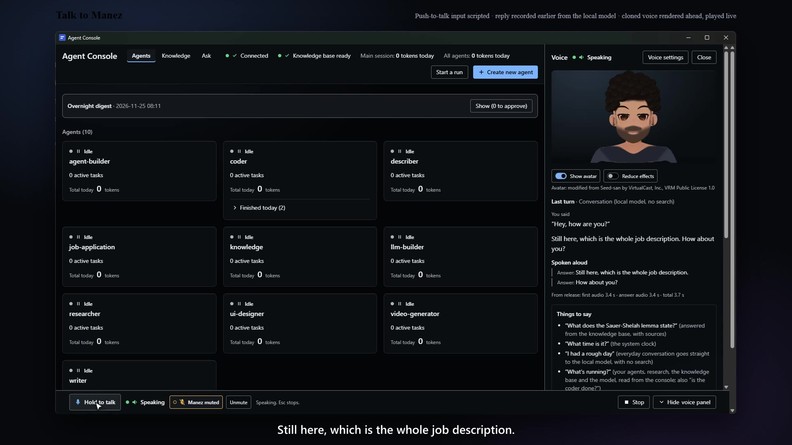
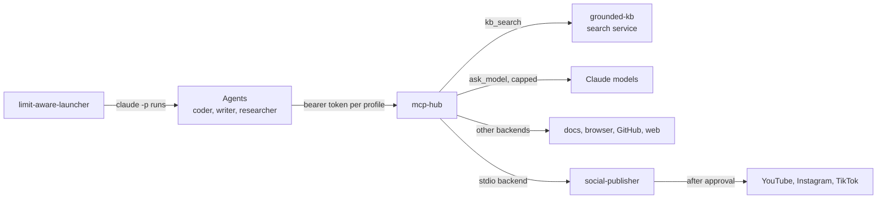

# Manez

AI agents that run under enforced rules and answer from a knowledge base that shows its sources.

*Demo video, 1 min 43 s. Click the image to play it.*

## What and why

I created a bunch of AI agents over the years. I wanted one place to see what they were all doing and to monitor token use. I also wanted to give the system as much knowledge as possible, with a visual of everything it holds in context. So I built Manez: a console with an agent and task view, per-task token and cost tracking, and a 3D graph of the knowledge base.

The idea behind it has three parts. Agents run under rules (tool allow-lists, spend caps, usage-limit holds). Answers come from cited knowledge. Results are measured, and I report the fixes that didn't work.

## Headline results

Retrieval and router numbers were measured on my private corpus (about 950k chunks) and private held-out sets. They can't be reproduced from what is published. Each repo ships an example eval so you can run the harness on your own data.

- The knowledge base holds 950,660 chunks across 5,108 documents, sorted into 197 topic hubs by meaning, across folders.
- Hybrid retrieval reached nDCG@10 of 0.842 on a 657k-chunk build, against 0.830 for dense search and 0.828 for BM25 alone.
- A learned router backstop lifted held-out accuracy from 75.9% to 86.1%, with 0 false overrides.
- A QLoRA fine-tune of Qwen3-4B, trained on a free Kaggle T4, went from 96.8% to 98.7% tool-call accuracy on 155 held-out cases.
- A one-line prompt fix for the same tool-call errors scored 94.2%, worse than the base model. I wrote it up and left it off.
- A cost study showed the spend is in agent sessions, not chat.
- The hub's example config caps all model spend at $20 a month, with every call in a ledger and an audit log.

The router and the Qwen3-4B adapter are not part of the published repos.

## What is published

Four repos, each usable on its own.

| Repo | What it does |
|---|---|
| [mcp-hub](https://github.com/ARMINSHIVES/mcp-hub) | One local gateway for agents. Each gets its own tool allow-list, tool definitions are hashed and pinned (a changed tool is blocked until approved), and `ask_model` calls run under spend caps with a ledger and audit log |
| [grounded-kb](https://github.com/ARMINSHIVES/grounded-kb) | Hybrid search (dense, BM25, entity graph) and topic hubs over your own documents, served from a warm local process, so answers can cite a document and section |
| [limit-aware-launcher](https://github.com/ARMINSHIVES/limit-aware-launcher) | Runs headless `claude -p` jobs. Holds at 90% of a usage window, parks a run the limit stops, and resumes the same session after the reset |
| [social-publisher](https://github.com/ARMINSHIVES/social-publisher) | An MCP server that posts videos to your own YouTube, Instagram and TikTok accounts through official APIs, after you approve the exact file and caption |

## How they fit together

Agents reach everything through the hub, so a tool or a dollar passes one checkpoint. The hub's `kb` backend forwards to the `grounded-kb` search service, which is how an agent gets a cited answer. `social-publisher` can run as a stdio backend behind the hub or directly under Claude Code. The launcher sits outside the hub: it starts headless agent runs and keeps them inside the claude.ai usage windows.

## Not published

The console and the voice assistant themselves are not published. The console is the agent and task view, the token and cost tracking, and the 3D knowledge graph. They are built around my personal setup. The four repos above are the infrastructure underneath, extracted so you can use it on its own. The demo video at the top shows the console.

## Limits

- Only Windows was tested, across all four repos.
- Each repo says what it doesn't cover. Read its "Limits and known gaps" section before relying on it.

## Licence

All four repos are MIT, Armaan Francisco Shivpuri. `grounded-kb` treats PyMuPDF (AGPL-3.0) as an optional extra and downloads MSC2020 data by script instead of bundling it. `social-publisher` uses official APIs only and has an approval gate. Details are in each repo.
